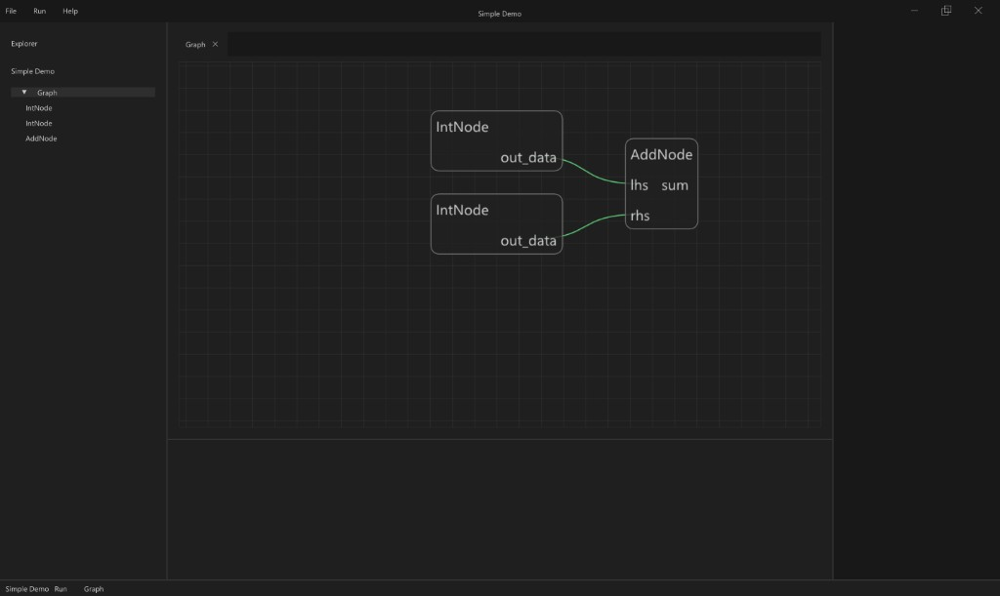

[](https://github.com/QiuYilin/taskgraph/actions/workflows/windows-2025.yml)

[](https://github.com/QiuYilin/taskgraph/actions/workflows/ubuntu-22.04.yml)

[](https://github.com/QiuYilin/taskgraph/actions/workflows/macos-15.yml)

# TaskGraph

A C++17 wrapper around [taskflow](https://github.com/taskflow/taskflow) for data-flow graphs, with an optional ImGui workbench.

# Dependencies

C++17. Prefer [vcpkg](https://github.com/microsoft/vcpkg). Taskflow must be **3.11.0** (last release that builds as C++17); take it from the personal registry [QiuYilin/vcpkg-registry](https://github.com/QiuYilin/vcpkg-registry).

## Classic mode

Copy the `registries` entry from [`.github/manifest/vcpkg-configuration.json`](.github/manifest/vcpkg-configuration.json) into `vcpkg-configuration.json` at the vcpkg root. Add `default-registry` and set its `baseline` to the commit of that vcpkg checkout. `taskflow` resolves from the personal registry; other ports stay on that checkout.

```
vcpkg install taskflow spdlog nlohmann-json
```

For **core + ui**, also install `portable-file-dialogs`.

## Manifest mode

Use [`.github/manifest/vcpkg.json`](.github/manifest/vcpkg.json) and [`.github/manifest/vcpkg-configuration.json`](.github/manifest/vcpkg-configuration.json). `BUILD_UI` and `BUILD_EXAMPLES` select the `ui` and `examples` features.

# Usage

## core

Build a graph with `tg::Controller` / `tg::Graph`, connect ports by caption names (`outport.out_data`, `inport.lhs`, …), and `run`. No window required; pair core with another UI if you prefer.

```
#include "taskgraph.hpp"
#include "AddNode.hpp"
#include "IntNode.hpp"
int main() {
    tg::Controller project;
    auto graph = std::make_shared<tg::Graph>();
    project.addGraph(graph);
    auto node1 = std::make_shared<tg::IntNode>();
    node1->setProperty(1);
    auto node2 = std::make_shared<tg::IntNode>();
    node2->setProperty(2);
    auto node3 = std::make_shared<tg::AddNode>();
    graph->addNode(node1);
    graph->addNode(node2);
    graph->addNode(node3);
    graph->connect(node1->outport.out_data, node3->inport.lhs);
    graph->connect(node2->outport.out_data, node3->inport.rhs);
    project.run(*graph);
    return 0;
}
```

## core + ui

Same `tg::Controller`: register kinds and open a project on **core**, then wrap with `Ui` and `Run()` for a VS Code–style workbench.



- Project on disk: directory with `project.json`, `graphs/`, `assets/`. File menu: New / Open / Save. Paths under the root are stored relative; session lives in user config as `taskgraph/session.json`.
- Canvas wires follow port types. Input ports and properties are two presentations of the same slot (**Convert to Property** / **Convert to Port**).
- Register with a stable `type_id` matching `Node::getName()` (optional UI `caption`). `simple` ships a `demo-project` template in source; the build copies it next to the executable and `openProject` opens that copy so edits do not dirty the repo.

```
#include "taskgraph.hpp"
#include "AddNode.hpp"
#include "IntNode.hpp"
#include "Ui.hpp"
int main() {
    tg::Controller project;
    project.registerNodeType(
        "IntNode", [] { return std::make_shared<tg::IntNode>(); }, "Int");
    project.registerNodeType(
        "AddNode", [] { return std::make_shared<tg::AddNode>(); }, "Add");
    project.openProject(/* demo-project next to the executable */);
    Ui ui(project);
    ui.Run();
    return 0;
}
```

