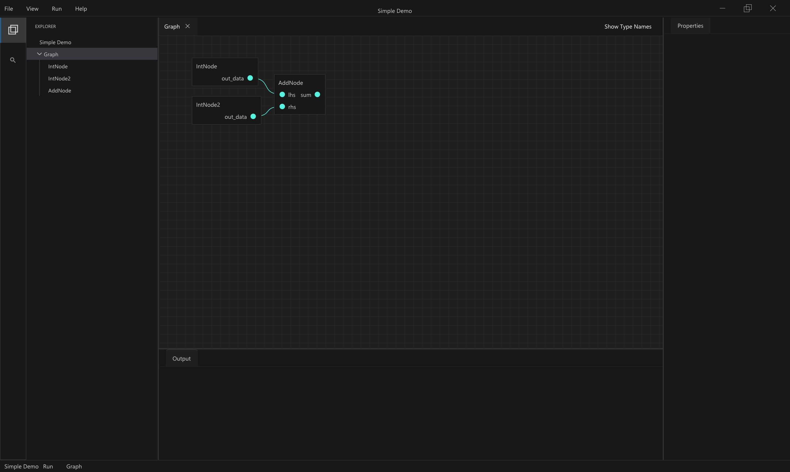
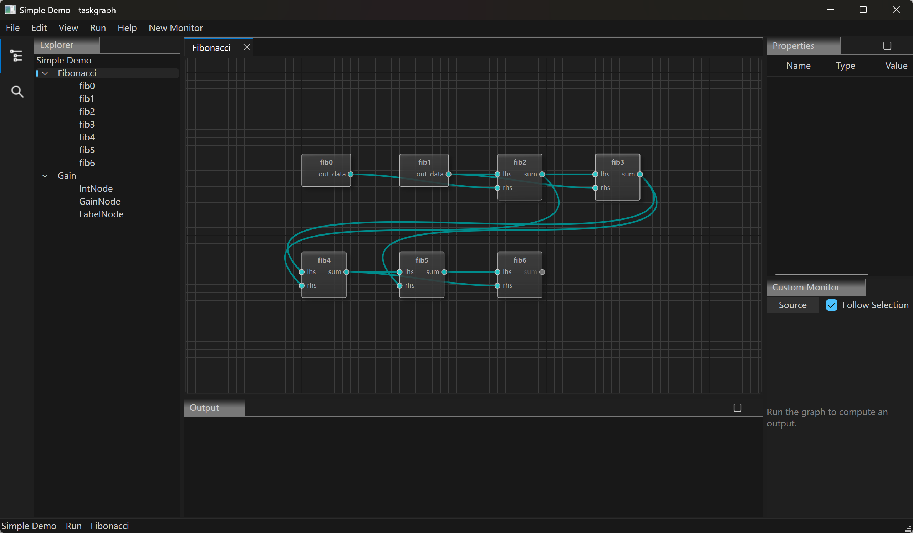

[](https://github.com/QiuYilin/taskgraph/actions/workflows/windows-2025.yml)

[](https://github.com/QiuYilin/taskgraph/actions/workflows/ubuntu-22.04.yml)

[](https://github.com/QiuYilin/taskgraph/actions/workflows/macos-15.yml)

# TaskGraph

A C++17 wrapper around [taskflow](https://github.com/taskflow/taskflow) for data-flow graphs, with an optional workbench built on ImGui or Qt. Its main purpose is to make algorithms that break down into operator pipelines easier to write and debug: every operator is a typed node, an edge is a binding, and the whole pipeline can be edited, inspected and run as a graph.

It can also be seen as an integration of a few awesome C++ projects: taskflow for scheduling, and for the workbench either ImGui with imgui-node-editor or Qt with QtNodes.

Taskgraph currently satisfies ANF and acyclic term graphs: a graph is a first-order, single-assignment, acyclic term. An edge is a binding. One `run` computes the term's value.

## Modules

| Path | Target | Contents |
| --- | --- | --- |
| `core/` | `taskgraph::Core` | `Controller`, `Graph`, `Node`, node data, project I/O and logging; no UI dependencies. |
| `ui/model/` | `taskgraph::UiModel` | Header-only, backend-neutral state shared by both workbenches: session, themes, explorer/edits/clipboard logic, path dialog. |
| `ui/imgui/` | `taskgraph::Ui` | ImGui workbench: docking plus an imgui-node-editor canvas. |
| `ui/qt/` | `taskgraph::Ui` | Qt workbench: Qt 6 widgets, a QtNodes canvas, and a Qt-Advanced-Docking-System shell. |
| `examples/` | — | `simple-core`, `simple-ui` (ImGui), `simple-qt` (Qt). |
| `tests/` | — | `core/` (gtest), `ui/` (gtest, ImGui only), `qt/` (QtTest). |

Only one workbench is built at a time; `TASKGRAPH_UI` selects it.

# Dependencies

C++17. Prefer [vcpkg](https://github.com/microsoft/vcpkg). Taskflow must be **3.11.0** (last release that builds as C++17); take it from the personal registry [QiuYilin/vcpkg-registry](https://github.com/QiuYilin/vcpkg-registry).

## Classic mode

Copy the `registries` entry from [`.github/manifest/vcpkg-configuration.json`](.github/manifest/vcpkg-configuration.json) into `vcpkg-configuration.json` at the vcpkg root. Add `default-registry` and set its `baseline` to the commit of that vcpkg checkout. `taskflow` resolves from the personal registry; other ports stay on that checkout.

Base (core and core tests):

```
vcpkg install taskflow spdlog nlohmann-json gtest
```

`TASKGRAPH_UI=imgui` (the default) additionally needs:

```
vcpkg install imgui[glfw-binding,opengl3-binding,docking-experimental] opengl imgui-node-editor portable-file-dialogs
```

`TASKGRAPH_UI=qt` additionally needs:

```
vcpkg install qtbase qtnodeeditor qt-advanced-docking-system portable-file-dialogs
```

## Manifest mode

Use [`.github/manifest/vcpkg.json`](.github/manifest/vcpkg.json) and [`.github/manifest/vcpkg-configuration.json`](.github/manifest/vcpkg-configuration.json). `TASKGRAPH_UI` adds the matching `ui-imgui` or `ui-qt` vcpkg feature; `BUILD_EXAMPLES` only controls whether the examples are built.

# Build

On Windows, `CMakePresets.json` provides `imgui` and `qt` configure presets (Visual Studio 2026, vcpkg at `C:\vcpkg`) plus `imgui-debug`, `imgui-release`, `qt-debug` and `qt-release` build presets:

```
cmake --preset imgui
cmake --build --preset imgui-debug
```

Use `--preset qt` / `--build --preset qt-debug` for the Qt workbench. Elsewhere, configure directly:

```
cmake -S . -B build -DCMAKE_TOOLCHAIN_FILE=<vcpkg>/scripts/buildsystems/vcpkg.cmake -DTASKGRAPH_UI=imgui
cmake --build build --config Release
```

| Option | Values | Default | Meaning |
| --- | --- | --- | --- |
| `TASKGRAPH_UI` | `imgui`, `qt`, `none` | `imgui` | Workbench backend; `none` builds core only. |
| `BUILD_EXAMPLES` | `ON` / `OFF` | `ON` | Build `simple-core` and the matching `simple-ui` or `simple-qt`. |
| `BUILD_TESTING` | `ON` / `OFF` | `ON` | Build the tests that match the backend. |

Executables land in `bin/<config>/` under the build directory (`out/build/<preset>/bin/<config>/` when using the presets). On Windows the Qt example runs `windeployqt` after linking, so Qt DLLs and the platform plugin sit next to the executable.

# Tests

```
ctest --test-dir build -C Debug --output-on-failure
```

`tests/core` runs with any backend. `tests/ui` (gtest) is built only for `TASKGRAPH_UI=imgui`; `tests/qt` (QtTest) is built only for `qt`, and ctest runs those headless with `QT_QPA_PLATFORM=offscreen`. CI builds the ImGui backend on windows-2025, ubuntu-22.04 and macos-15.

# Usage

## core

Build a graph with `tg::Controller` / `tg::Graph`, connect ports by caption names (`outport.out_data`, `inport.lhs`, …) and the data type (`connect<IntData_t>`), and `run`. A handwritten literal uses `setProperty<IntData_t>(input, value)`, naming the data type the same way as `connect`. It writes that input, disconnects incoming edges, and shows the slot as a property. Assigning to `inport` does not compile. A setting that is not an input yet is a `Prop<T>`, written with the same `setProperty`. No window required; pair core with another UI if you prefer. `addNode` ignores a node that already belongs to a graph. `connect` rejects a second source on the same input and any edge that would close a cycle. Data edges between the same two nodes share one schedule edge, removed with the last of those data edges. The editor and saved projects still call the runtime `connect` on port pointers; a mismatched `DataT` in handwritten code does not compile.

```
#include "taskgraph/taskgraph.hpp"
#include "AddNode.hpp"
#include "IntNode.hpp"
#include <iostream>
#include <memory>
int main() {
    tg::Controller project;
    auto graph = project.createGraph();
    auto node1 = graph->createNode<IntNode>();
    node1->setProperty<IntData_t>(node1->inport.value, 1);
    auto node2 = graph->createNode<IntNode>();
    node2->setProperty<IntData_t>(node2->inport.value, 2);
    auto node3 = graph->createNode<AddNode>();
    graph->connect<IntData_t>(node1->outport.out_data, node3->inport.lhs);
    graph->connect<IntData_t>(node2->outport.out_data, node3->inport.rhs);
    if (const auto error = project.tryRun(*graph)) {
        std::cerr << *error << '\n';
        return 1;
    }
    const auto sum = node3->outport.sum.nodeData();
    if (sum == nullptr) {
        return 1;
    }
    std::cout << sum->data() << '\n';
    return 0;
}
```

## core + ui

Same `tg::Controller`: register kinds and open a project on **core**, then wrap with `Ui` and `Run()` for a VS Code–style workbench. Two backends share the same core and models; the interaction details for both are in [`docs/ui.md`](docs/ui.md).



### ImGui build

The default backend: a docking workbench with an activity bar, Explorer/Search, an imgui-node-editor canvas, the Properties table, the Output panel, and the Dark Modern / Light Modern themes.

```
#include "taskgraph/taskgraph.hpp"
#include "AddNode.hpp"
#include "IntNode.hpp"
#include "Ui.hpp"
int main() {
    tg::Controller project;
    project.registerNodeType<IntNode>();
    project.registerNodeType<AddNode>();
    project.openProject(/* demo-project next to the executable */);
    Ui ui(project);
    ui.Run();
    return 0;
}
```

### Qt build

`TASKGRAPH_UI=qt`. A `QMainWindow` with Qt-Advanced-Docking-System docks and a QtNodes canvas; the program owns the `QApplication` and event loop.

```
#include "taskgraph/taskgraph.hpp"
#include "AddNode.hpp"
#include "IntNode.hpp"
#include "Ui.hpp"
#include <QApplication>
int main(int argc, char** argv) {
    QApplication app(argc, argv);
    tg::Controller project;
    project.registerNodeType<IntNode>();
    project.registerNodeType<AddNode>();
    project.openProject(/* demo-project next to the executable */);
    Ui ui(project);
    ui.Run();
    return app.exec();
}
```



### Why two UI backends

One reason for writing two is to show that the core is not tied to any UI framework: `taskgraph::Core` has no UI dependency, and both backends are just observers over the same models. ImGui's immediate mode makes UI code easy to keep refining with AI: the frame is rebuilt from the current state every time, so a change stays local and shows up at once. The Qt build follows model/view, and the latest QtNodes supports MVD, so the canvas is only an adapter over the same project and graph models that the tree, tabs and property table observe. With that separation, AI can implement and extend the UI very quickly.
