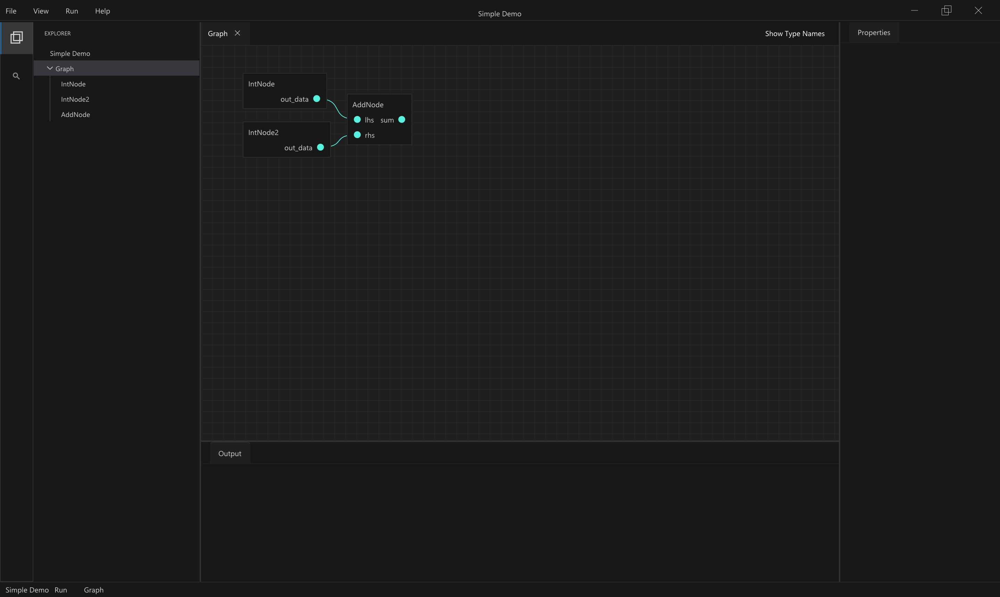
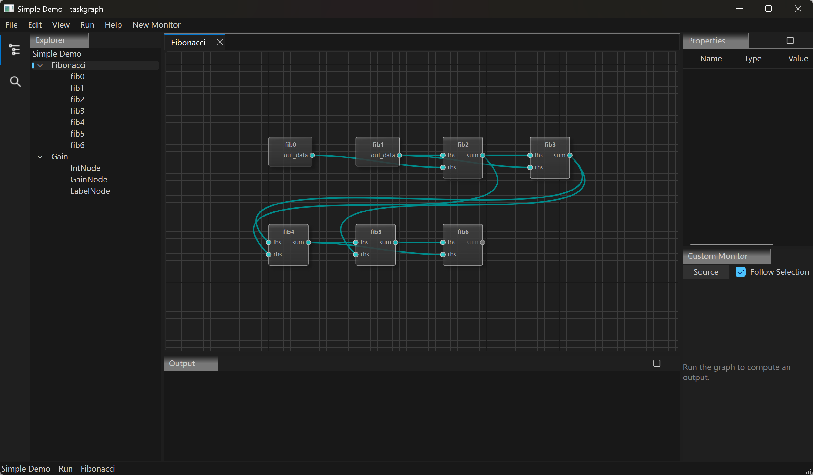

[](https://github.com/QiuYilin/taskgraph/actions/workflows/windows-2025.yml)

[](https://github.com/QiuYilin/taskgraph/actions/workflows/ubuntu-22.04.yml)

[](https://github.com/QiuYilin/taskgraph/actions/workflows/macos-15.yml)

# taskgraph

对并行任务框架 [taskflow](https://github.com/taskflow/taskflow) 的 C++17 包装，面向数据流图，并可选提供 ImGui 或 Qt 工作台。核心用途是简化编写和调试能拆成算子流水线的算法：每个算子是一个带类型的节点，边是绑定，整条流水线可以当作一张图来编辑、检查和运行。

也可以把它看作几个 C++ awesome 项目的整合：调度来自 taskflow，工作台在 imgui 版用 ImGui 与 imgui-node-editor，在 Qt 版用 Qt 与 QtNodes。

taskgraph 目前满足 ANF 和无环项图：一张图是一阶、单赋值、无环的项。边是绑定。一次 `run` 算出这个项的值。

## 模块

| 路径 | 目标 | 内容 |
| --- | --- | --- |
| `core/` | `taskgraph::Core` | `Controller`、`Graph`、`Node`、节点数据、工程读写和日志；不依赖 UI。 |
| `ui/model/` | `taskgraph::UiModel` | 只含头文件、与后端无关的状态（Facade）：会话、主题、主侧栏/编辑区/剪贴板逻辑、路径对话框。 |
| `ui/imgui/` | `taskgraph::Ui` | ImGui 工作台：停靠加 imgui-node-editor 画布。 |
| `ui/qt/` | `taskgraph::Ui` | Qt 工作台：Qt 6 控件、QtNodes 画布、Qt-Advanced-Docking-System 外壳。 |
| `examples/` | — | `simple-core`、`simple-ui`（ImGui）、`simple-qt`（Qt）。 |
| `tests/` | — | `core/`（gtest）、`ui/`（gtest，仅 ImGui）、`qt/`（QtTest）。 |

同一时间只构建一个工作台，由 `TASKGRAPH_UI` 选择。

# 依赖

C++17。推荐用 [vcpkg](https://github.com/microsoft/vcpkg)。Taskflow 须为 **3.11.0**（最后一个可按 C++17 编译的版本），请用个人注册表 [QiuYilin/vcpkg-registry](https://github.com/QiuYilin/vcpkg-registry)。

## 全局模式

把 [`.github/manifest/vcpkg-configuration.json`](.github/manifest/vcpkg-configuration.json) 里的 `registries` 放进 vcpkg 根目录的 `vcpkg-configuration.json`，并补上 `default-registry`，把它的 `baseline` 写成这份 vcpkg 检出的提交。`taskflow` 从个人注册表解析，其余端口仍来自这份检出。

基础（core 与 core 测试）：

```
vcpkg install taskflow spdlog nlohmann-json gtest
```

`TASKGRAPH_UI=imgui`（默认）另需：

```
vcpkg install imgui[glfw-binding,opengl3-binding,docking-experimental] opengl imgui-node-editor portable-file-dialogs
```

`TASKGRAPH_UI=qt` 另需：

```
vcpkg install qtbase qtnodeeditor qt-advanced-docking-system portable-file-dialogs
```

## 清单模式

使用 [`.github/manifest/vcpkg.json`](.github/manifest/vcpkg.json) 和 [`.github/manifest/vcpkg-configuration.json`](.github/manifest/vcpkg-configuration.json)。`TASKGRAPH_UI` 会加上对应的 `ui-imgui` 或 `ui-qt` 特性；`BUILD_EXAMPLES` 只决定是否构建示例。

# 构建

Windows 上用 `CMakePresets.json` 里的 `imgui` / `qt` 配置预设（Visual Studio 2026，vcpkg 在 `C:\vcpkg`），以及 `imgui-debug`、`imgui-release`、`qt-debug`、`qt-release` 构建预设：

```
cmake --preset imgui
cmake --build --preset imgui-debug
```

Qt 工作台换成 `--preset qt` / `--build --preset qt-debug`。其它平台直接配置：

```
cmake -S . -B build -DCMAKE_TOOLCHAIN_FILE=<vcpkg>/scripts/buildsystems/vcpkg.cmake -DTASKGRAPH_UI=imgui
cmake --build build --config Release
```

| 选项 | 取值 | 默认 | 含义 |
| --- | --- | --- | --- |
| `TASKGRAPH_UI` | `imgui`、`qt`、`none` | `imgui` | 工作台后端；`none` 只构建 core。 |
| `BUILD_EXAMPLES` | `ON` / `OFF` | `ON` | 构建 `simple-core` 和对应的 `simple-ui` 或 `simple-qt`。 |
| `BUILD_TESTING` | `ON` / `OFF` | `ON` | 构建与后端匹配的测试。 |

可执行文件在构建目录的 `bin/<config>/`（用预设时是 `out/build/<preset>/bin/<config>/`）。Windows 上 Qt 示例链接后会跑 `windeployqt`，Qt DLL 和平台插件就在 exe 旁。

# 测试

```
ctest --test-dir build -C Debug --output-on-failure
```

`tests/core` 在任何后端下都跑。`tests/ui`（gtest）只在 `TASKGRAPH_UI=imgui` 时编译；`tests/qt`（QtTest）只在 `qt` 时编译，ctest 用 `QT_QPA_PLATFORM=offscreen` 无界面运行。CI 在 windows-2025、ubuntu-22.04、macos-15 上构建 ImGui 后端。

# 用法

## core

用 `tg::Controller` / `tg::Graph` 建图，按引脚功能名连端口（如 `outport.out_data`、`inport.lhs`），并在 `connect<IntData_t>` 上写出数据类型，再 `run`。手写常量用 `setProperty<IntData_t>(输入端口, 值)`，和 `connect` 一样写出数据类型：写入该输入、断开它的入边，并把露面改成属性。`inport = 值` 编不过。还没有输入槽的配置是 `Prop<T>`，同样用 `setProperty` 写入。不需要窗口；也可只拿 core 配别的界面。`addNode` 不再接收已经属于某张图的节点。`connect` 拒绝同一个输入的第二个上游，也拒绝会成环的边。同一对节点之间的数据边共用一条调度边，最后一条数据边删掉时调度边一起拆掉。编辑区和工程文件仍用端口指针的运行时 `connect`；手写代码里 `DataT` 不一致则编不过。

```
#include "taskgraph/taskgraph.hpp"
#include "AddNode.hpp"
#include "IntNode.hpp"
#include <iostream>
#include <memory>
int main() {
    tg::Controller project;
    auto graph = project.createGraph();
    auto node1 = graph->createNode<IntNode>();
    node1->setProperty<IntData_t>(node1->inport.value, 1);
    auto node2 = graph->createNode<IntNode>();
    node2->setProperty<IntData_t>(node2->inport.value, 2);
    auto node3 = graph->createNode<AddNode>();
    graph->connect<IntData_t>(node1->outport.out_data, node3->inport.lhs);
    graph->connect<IntData_t>(node2->outport.out_data, node3->inport.rhs);
    if (const auto error = project.tryRun(*graph)) {
        std::cerr << *error << '\n';
        return 1;
    }
    const auto sum = node3->outport.sum.nodeData();
    if (sum == nullptr) {
        return 1;
    }
    std::cout << sum->data() << '\n';
    return 0;
}
```

## core + ui

仍用同一个 `tg::Controller`：在 **core** 上登记种类并打开工程，再套上 `Ui` 调用 `Run()`，得到 VS Code 风格工作台。两个后端共用同一份 core 和模型；两边的交互细节都在 [`docs/ui.md`](docs/ui.md)。



### ImGui 版

默认后端：带活动栏、Explorer/Search、imgui-node-editor 画布、属性表、Output 面板和 Dark Modern / Light Modern 主题的停靠工作台。

```
#include "taskgraph/taskgraph.hpp"
#include "AddNode.hpp"
#include "IntNode.hpp"
#include "Ui.hpp"
int main() {
    tg::Controller project;
    project.registerNodeType<IntNode>();
    project.registerNodeType<AddNode>();
    project.openProject(/* 可执行文件旁的 demo-project 副本 */);
    Ui ui(project);
    ui.Run();
    return 0;
}
```

### Qt 版

`TASKGRAPH_UI=qt`。`QMainWindow` 配 Qt-Advanced-Docking-System 停靠和 QtNodes 画布；`QApplication` 和事件循环由程序自己持有。

```
#include "taskgraph/taskgraph.hpp"
#include "AddNode.hpp"
#include "IntNode.hpp"
#include "Ui.hpp"
#include <QApplication>
int main(int argc, char** argv) {
    QApplication app(argc, argv);
    tg::Controller project;
    project.registerNodeType<IntNode>();
    project.registerNodeType<AddNode>();
    project.openProject(/* 可执行文件旁的 demo-project 副本 */);
    Ui ui(project);
    ui.Run();
    return app.exec();
}
```



### 为什么写两套 UI

一部分原因是为了说明 core 能被任意 UI 框架使用：`taskgraph::Core` 不依赖任何 UI，两个前端都只是同一份模型上的观察者。imgui 版用 imgui-node-editor；立即模式很适合让 AI 随时完善 UI 代码：每一帧都从当前状态重建，改动集中在一处，改完立刻能看见。Qt 版基于 QtNodes，最新版支持 MVD，画布只是适配器，观察的仍是主侧栏、页签和属性表共用的工程/图模型；按 MVD 分层写下来，AI 实现 UI 的速度非常快。
