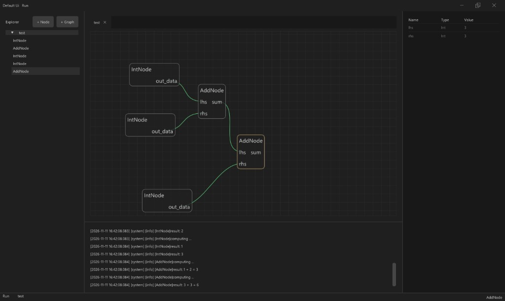

[](https://github.com/QiuYilin/taskgraph/actions/workflows/windows-2025.yml)

[](https://github.com/QiuYilin/taskgraph/actions/workflows/ubuntu-22.04.yml)

[](https://github.com/QiuYilin/taskgraph/actions/workflows/macos-15.yml)

# taskgraph
对并行任务框架taskflow[https://github.com/taskflow/taskflow]的包装，使其能够满足数据流编程的需求，并且提供界面组件。

# 依赖

本库使用 C++17。建议用 [vcpkg](https://github.com/microsoft/vcpkg) 安装依赖，并从 [QiuYilin/vcpkg-registry](https://github.com/QiuYilin/vcpkg-registry) 获取 Taskflow 3.11.0。这个注册表保留最后一个可以按 C++17 编译的 Taskflow 版本。

## 全局模式

把 [`.github/manifest/vcpkg-configuration.json`](.github/manifest/vcpkg-configuration.json) 里的 `registries` 放进 vcpkg 根目录的 `vcpkg-configuration.json`，并补上 `default-registry`，把它的 `baseline` 写成这份 vcpkg 检出的提交。`taskflow` 从个人注册表解析，其余端口仍来自这份检出。

```
vcpkg install taskflow
```

## 清单模式

使用 [`.github/manifest/vcpkg.json`](.github/manifest/vcpkg.json) 和 [`.github/manifest/vcpkg-configuration.json`](.github/manifest/vcpkg-configuration.json)。`BUILD_UI` 和 `BUILD_EXAMPLES` 分别打开 `ui` 与 `examples` 特性。

# 用法

用法分两种：**core**，以及 **core + ui**。

## core

用 `tg::Controller` / `tg::Graph` 建图、连端口并运行。端口访问器名称与引脚功能名一致（如 `outport.out_data`、`inport.lhs`）。不需要窗口或 ImGui。core 也可以和别的界面方案组合，例如 Qt、Web 前端或自研界面，不必使用本仓库自带的 `ui` 模块。

```
#include "taskgraph.hpp"
#include "AddNode.hpp"
#include "IntNode.hpp"
int main() {
    tg::Controller project;
    auto graph = std::make_shared<tg::Graph>();
    project.addGraph(graph);
    auto node1 = std::make_shared<tg::IntNode>();
    node1->setProperty(1);
    auto node2 = std::make_shared<tg::IntNode>();
    node2->setProperty(2);
    auto node3 = std::make_shared<tg::AddNode>();
    graph->addNode(node1);
    graph->addNode(node2);
    graph->addNode(node3);
    graph->connect(node1->outport.out_data, node3->inport.lhs);
    graph->connect(node2->outport.out_data, node3->inport.rhs);
    project.run(*graph);
    return 0;
}
```

## core + ui

仍使用同一个 `tg::Controller`，在 `Ui` 上登记节点种类后调用 `Run()`，得到 VS Code 风格工作台（Explorer、画布、Properties、输出日志）。也可以继续用代码建图或运行；界面改的是这份控制器。



画布连线颜色按端口数据类型（不符为红并拒绝）。输入端口与属性是同一槽位的两种露面：引脚或 Properties 右键 **Convert to Property** / **Convert to Port**。图像、点云类输入在属性模式下为文件路径。初始没有输入口的节点只有普通属性。

```
#include "taskgraph.hpp"
#include "AddNode.hpp"
#include "IntNode.hpp"
#include "Ui.hpp"
int main() {
    tg::Controller project;
    Ui ui(project);
    ui.addNodeKind("Int", [] { return std::make_shared<tg::IntNode>(); });
    ui.addNodeKind("Add", [] { return std::make_shared<tg::AddNode>(); });
    ui.Run();
    return 0;
}
```
